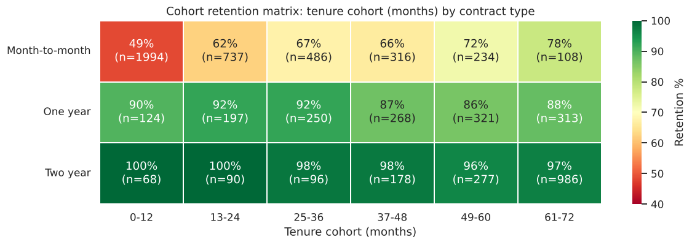
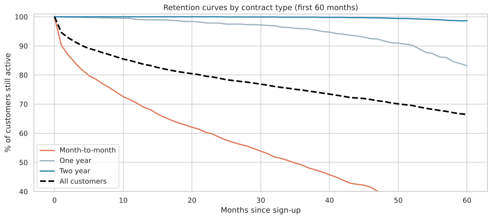
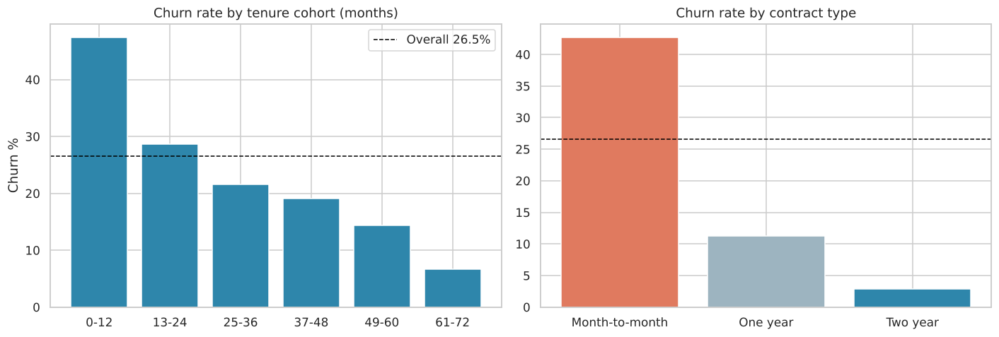
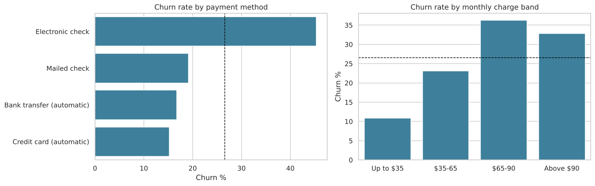
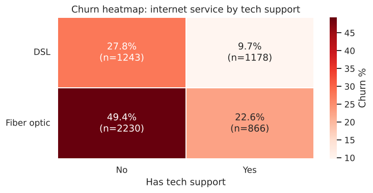
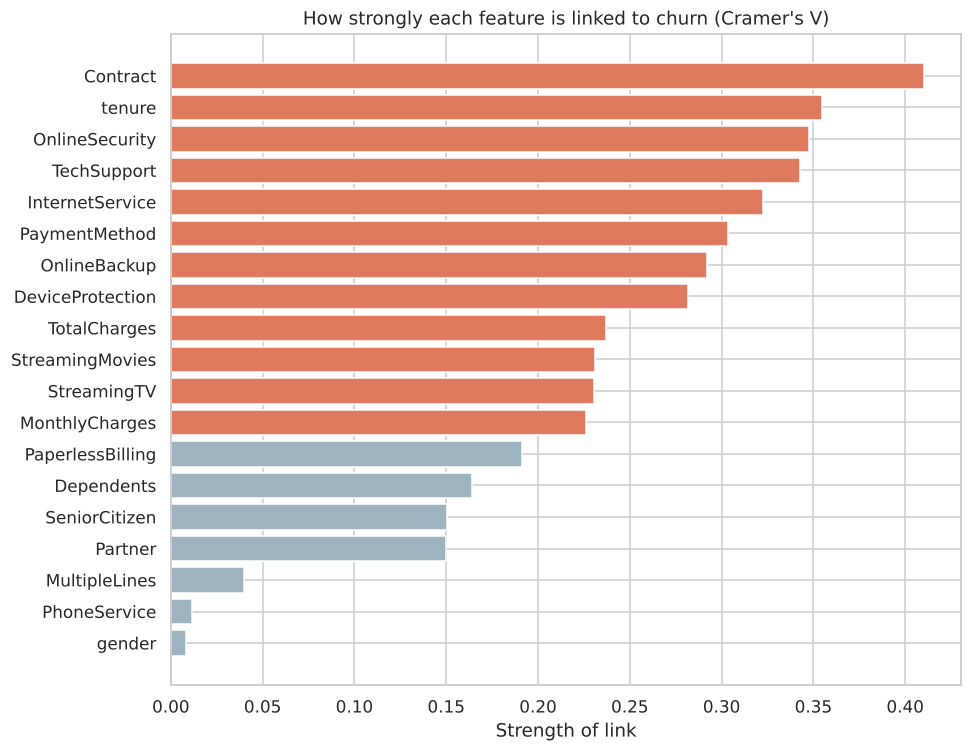
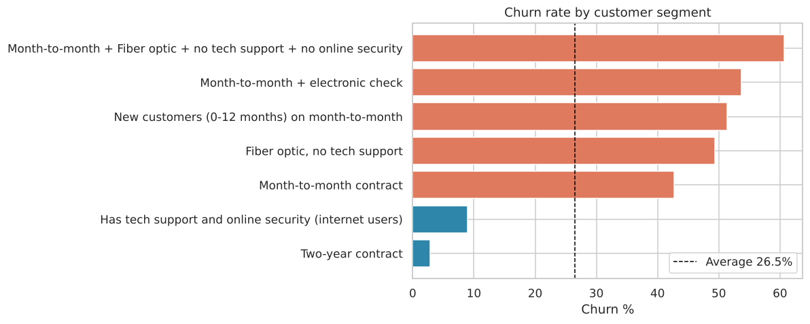

# Churn Analysis Report: IBM Telco Customer Churn

**Dataset:** 7,043 customers, 21 columns. **Notebook:** `Task3_Churn_Cohort_Analysis.ipynb`

**Method:** churn rate = churned customers / total customers. Customers were grouped into 12-month tenure cohorts and by contract type. Retention curves use the Kaplan-Meier method, which handles customers who are still active. Drivers were ranked with Cramer's V.

## Cohort retention matrix

## Retention curves by contract type

## Churn by tenure cohort and contract

## Payment method and monthly charges

## Service tier heatmap

## What drives churn

## High-risk segments

## Findings and retention recommendations

**Baseline:** 1,869 of 7,043 customers churned, a churn rate of **26.5%**. Those customers paid $139K a month, which is 30.5% of total monthly billing.

### What the data shows

**1. The first year is where customers are lost.**
The 0-12 month cohort has a 47.4% churn rate. It holds 55.5% of everyone who ever churned. By the 61-72 month cohort churn is down to 6.6%. A customer who survives year one is far more likely to stay.

**2. Contract type is the strongest churn driver.**
Month-to-month customers churn at 42.7%, one-year customers at 11.3% and two-year customers at 2.8%. Month-to-month is 55% of the base but 88.6% of all churners. On the retention curves, 70% of month-to-month customers are still active at month 12 and 30% at month 60. For one-year contracts the figures are 99% and 83%, and for two-year contracts 100% and 99%.

**3. Fiber optic customers leave much more often than DSL customers.**
Fiber churn is 41.9% against 19.0% for DSL and 7.4% for customers with no internet. Fiber is also the most expensive plan ($91.50 average bill against $58.10 for DSL). Churn is highest in the $65-90 band (36.3%), and churned customers paid more on average ($74 against $61).

**4. Support and security add-ons are linked to much lower churn.**
Customers without Online Security churn at 41.8% against 14.6% for those with it. The Tech Support gap is similar (41.6% against 15.2%). Fiber customers without tech support churn at 49.4%, and with tech support at 22.6%. Streaming add-ons show almost no gap (about 3.5 points). This is a link, not proof of cause: customers who take these add-ons may simply be more engaged.

**5. Electronic check payers are the most likely to leave.**
Electronic check churn is 45.3%, against 15.2% to 19.1% for every other method. Inside the month-to-month group the gap holds (53.7% against about 32% to 34%). Electronic check is used by 33.6% of customers. Automatic payment customers are more settled.

**6. Senior citizens churn more, gender makes no difference.**
Senior citizens churn at 41.7% against 23.6% for others. Female and male churn are almost the same (26.9% and 26.2%).

### High-risk segments

| Segment | Customers | Churn rate | vs average | Monthly revenue lost |
|---|---|---|---|---|
| Month-to-month + Fiber + no tech support + no online security | 1,524 | 60.7% | 2.3x | $78.4K |
| Month-to-month + electronic check | 1,850 | 53.7% | 2.0x | $77.3K |
| New customers (0-12 months) on month-to-month | 1,994 | 51.4% | 1.9x | $68.3K |
| Fiber optic, no tech support | 2,230 | 49.4% | 1.9x | $94.9K |
| Month-to-month (all) | 3,875 | 42.7% | 1.6x | $120.8K |

For comparison, customers with both Tech Support and Online Security churn at only 9.0%, and two-year contract customers at 2.8%.

### Strategic retention recommendations

1. **Run a first-year program.** Add a welcome call in month 1 and check-ins at months 3 and 6 for every new customer. Start with the 1,994 new month-to-month customers, who churn at 51%.
2. **Move month-to-month customers to one-year contracts.** Offer a price lock or small discount at months 3 to 6. The data shows 42.7% against 11.3% churn, though part of that gap is because loyal customers choose longer contracts, so test the offer before rolling it out.
3. **Bundle Tech Support and Online Security for new Fiber customers.** Offer them free for the first 6 months and compare churn against a control group.
4. **Push electronic check customers to auto-pay.** A small monthly credit for switching to bank transfer or card is cheap compared with the revenue at stake.
5. **Review Fiber pricing and service quality.** A 42% churn rate on the highest-priced plan points to a value or reliability problem, not only a marketing one.
6. **Build an early-warning list.** Flag customers who match two or more risk traits (month-to-month, fiber, no add-ons, electronic check, under 12 months) and contact them first.

**Size of the prize:** every 1 point drop in overall churn keeps about 70 customers, or roughly $4.5K of monthly billing (simple arithmetic on the average bill of $64.76).

### Limits of this analysis
- The data is a single snapshot with no sign-up dates, so cohorts are built from tenure (months with the company).
- Churn links shown here are correlations. Offers should be tested before a full rollout.
- Cells with few customers (for example two-year contracts in the first 12 months) should be read with care.
